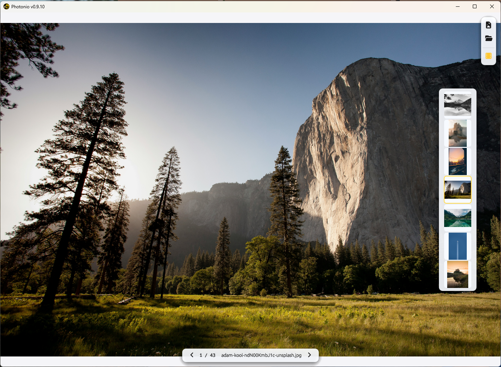
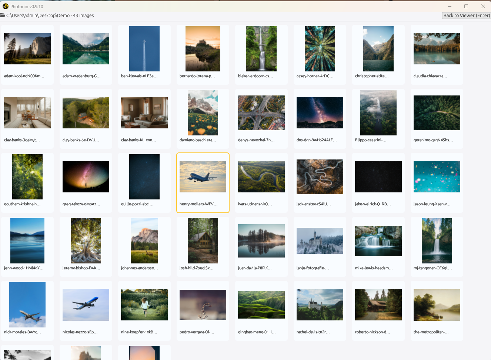
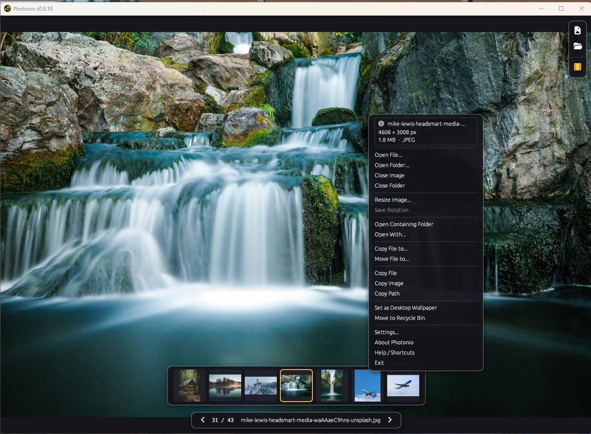
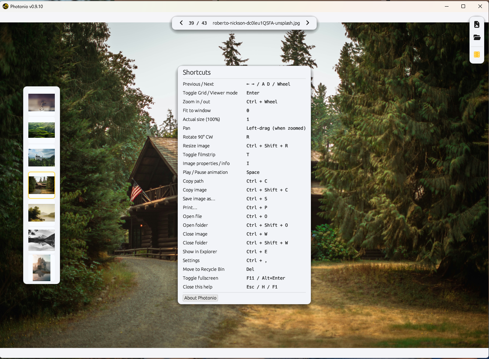

# Photonio

<p align="center">
  
</p>

<p align="center">
  <a href="#license"></a>
  
</p>

**A high-performance, lightweight, glassmorphic image viewer for Windows 10/11 — built in pure Rust with `egui`/`eframe`.**

Photonio puts your images on a clean, unobstructed canvas — no ribbon bars, no clutter. Decoding runs on dedicated background threads with priority scheduling, so browsing stays fluid even over large photo collections. The interface is a frosted-glass overlay with Font Awesome iconography and dynamic Light / Dark / Glass themes (Light by default).

## Screenshots

<p align="center">
  
  <br>
  
  
</p>

## Features

- **Fast, non-blocking loading** — full-res and thumbnail decoders run on separate worker threads with circular ring preloading and priority scheduling so the active image is always decoded first.
- **Multi-View Thumbnail Grid & Subfolder Explorer** — toggle seamlessly between single-image canvas and virtualized multi-view grid (`Enter` or double-click canvas), featuring interactive breadcrumbs with overflow `"..."` dropdown, direct path editing (`Ctrl + L`), live folder scanning, and subfolder cards with 2x2 media quad previews.
- **In-App Custom Folder Browser with Covers** — modern folder selector dialog with Quick Access pinned folders, full folder history navigation, dynamic folder cover previews generated from subfolder images, inline directory creation (`+ New Folder`), and theme-adaptive gold accents.
- **Folder History & Navigation** — traversal stack with Back (`Alt + ←`) and Forward (`Alt + →`) navigation across previously visited directories in both viewer and grid modes, plus parent folder jump (`Backspace` / `Alt + ↑`).
- **Lossless In-Place Rotation with Breathing Quick-Action Save** — fast 90° clockwise (`R`) and counter-clockwise (`Ctrl + R`) rotations with instant visual feedback; pending rotations trigger a pulsing breathing Save icon in the quick-action toolbar, overwriting losslessly with `Ctrl + S` or saving a copy with `Ctrl + Shift + S`.
- **Safe In-Place File Renaming** — inline modal (`F2` or context menu) with live Windows file-naming validation, DOS reserved name rejection (CON, PRN, AUX, etc.), NTFS case-only rename safety, and zero-flicker GPU texture remapping.
- **Image Resizer** — customizable resizing utility (`Ctrl + Shift + R`) with aspect ratio lock, percentage or pixel scaling, 5 interpolation filters (Lanczos3, Gaussian, Catmull-Rom, Triangle, Nearest), and real-time file size estimation.
- **Comprehensive EXIF & Metadata Inspector** — in-depth properties modal (`I`) displaying resolution, aspect ratio, megapixels, color depth, timestamps, camera make/model, lens, exposure time, F-number, ISO, and GPS coordinates.
- **Broad format support** — JPEG (including `.jfif`), PNG, BMP, GIF, TIFF, WebP, and ICO, with EXIF orientation applied automatically.
- **Animated playback** — multi-frame **GIF** and **Animated WebP** play, loop, pause (`Space`), and step frame-by-frame (`[` / `]`).
- **Dynamic filmstrip** — 4-way docking (Bottom / Top / Left / Right), aspect-ratio-preserving thumbnails, and a hotkey toggle (`T`).
- **Quick-Action Pill** — a customizable top-right icon toolbar (Open File, Open Folder, Save As, Print, Share, Toggle Filmstrip) with horizontal or vertical layouts, plus pulsing rotation save indicator.
- **Windows shell integration** — portable `HKCU` default-app registration (no admin), an Explorer folder context menu ("Open folder with Photonio"), CLI / double-click argument support, and in-process Win32 registry health checking with portable-path mismatch detection.
- **Frosted Glassmorphic theme** — translucent frosted panels with configurable opacity, dynamic Light / Dark / Glass canvas backgrounds, high-contrast theme-adaptive gold accents, and Font Awesome 7 Solid iconography.
- **Persistence** — remembers the exact last-viewed image, its folder, window geometry, and all settings in `%APPDATA%\Photonio\config.json`.

## Supported file types

| Format | Extensions | Notes |
| --- | --- | --- |
| JPEG | `.jpg` `.jpeg` `.jfif` | EXIF auto-rotation |
| PNG | `.png` | |
| GIF | `.gif` | Animated playback |
| WebP | `.webp` | Animated playback |
| BMP | `.bmp` | |
| TIFF | `.tif` `.tiff` | |
| ICO | `.ico` | |

Windows Explorer file association is registered for `.jpg`, `.jpeg`, `.jfif`, `.png`, `.webp`, `.bmp`, `.gif`, and `.tiff`.

## Keyboard shortcuts

### Navigation & Browsing
| Action | Keys |
| --- | --- |
| Previous / Next image | `←` `→` · `A` `D` · Mouse wheel |
| First / Last image in folder | `Home` · `End` |
| Toggle Multi-View Grid / Viewer | `Enter` · Double-click canvas |
| Focus address bar | `Ctrl` + `L` |
| Go to parent folder | `Backspace` · `Alt` + `↑` |
| Folder History: Back | `Alt` + `←` |
| Folder History: Forward | `Alt` + `→` |
| Preview size: bigger (in grid) | `Ctrl` + Wheel Up · `Ctrl` + `+` |
| Preview size: smaller (in grid) | `Ctrl` + Wheel Down · `Ctrl` + `-` |
| Preview size: reset (in grid) | `Ctrl` + `0` |
| Refresh folder | `F5` |

### Viewing & Zoom
| Action | Keys |
| --- | --- |
| Zoom in / out | `Ctrl` + Mouse wheel |
| Fit to window | `0` |
| Actual size (100%) | `1` |
| Pan (when zoomed) | Left-drag |
| Rotate 90° clockwise | `R` |
| Rotate 90° counter-clockwise | `Ctrl` + `R` |
| Toggle filmstrip | `T` |
| Toggle fullscreen | `F11` · `Alt` + `Enter` |

### File Operations & Tools
| Action | Keys |
| --- | --- |
| Image properties / EXIF | `I` |
| Resize image | `Ctrl` + `Shift` + `R` |
| Rename file | `F2` |
| Copy file path | `Ctrl` + `C` |
| Copy image to clipboard | `Ctrl` + `Shift` + `C` |
| Save rotation | `Ctrl` + `S` |
| Save image as… | `Ctrl` + `Shift` + `S` |
| Print image… | `Ctrl` + `P` |
| Move to Recycle Bin | `Del` |
| Show in File Explorer | `Ctrl` + `E` |

### General & Playback
| Action | Keys |
| --- | --- |
| Open file | `Ctrl` + `O` |
| Open folder | `Ctrl` + `Shift` + `O` |
| Close active image | `Ctrl` + `W` |
| Close folder | `Ctrl` + `Shift` + `W` |
| Play / Pause animation | `Space` |
| Step animation frame | `[` · `]` |
| Settings | `Ctrl` + `,` |
| Help & shortcuts | `F1` · `H` |
| Close modal / dismiss overlay | `Esc` |
| Context menu | Right-click |

## Building from source

**Prerequisites**

- Windows 10 or 11 (x64)
- Rust toolchain (stable, 2021 edition) — https://rustup.rs
- MSVC build tools — install the "Desktop development with C++" workload from the Visual Studio Build Tools.

```powershell
git clone https://github.com/limbo666/Photonio.git
cd Photonio
cargo build --release
.\target\release\photonio.exe
```

> **Always use `--release`.** Image decoding is 10–40× slower in debug builds.

The result is a **self-contained single executable** — no external C/C++ runtime, video codecs, or DLLs are required.

## Usage

- Open a file (`Ctrl+O`) or a folder (`Ctrl+Shift+O`), or drag-and-drop an image or folder onto the window.
- Pass a file or folder path on the command line, or use the Explorer **"Open folder with Photonio"** context menu.
- Photonio scans the containing folder with natural sort, so prev/next navigation and the filmstrip work around the opened image.
- Press `Enter` to switch into the Multi-View thumbnail grid to browse the folder, and double-click any thumbnail to view it full-screen.

## Settings

Configured in **Settings** (`Ctrl+,`) with a modern tabbed layout and persisted to `%APPDATA%\Photonio\config.json`:
- **Appearance**: Canvas background (Light / Dark / Glass) and adjustable frosted glass opacity.
- **General**: Remember last folder, remember last image, loop navigation, mouse wheel action (Navigate vs. Zoom), and HUD position / auto-hide.
- **Interface**: Filmstrip visibility and 4-way dock position (Bottom / Top / Left / Right), Quick-Action Pill visibility and layout (Horizontal / Vertical).
- **Integration**: In-process Win32 registry management for Windows Default App file associations and Explorer folder context menu ("Open folder with Photonio") with real-time health inspection.

## Project structure

| Path | Purpose |
| --- | --- |
| `src/main.rs` | Entry point, CLI argument ingestion, window lifecycle |
| `src/app.rs` | UI state, event handling, HUD, pill, filmstrip, grid mode, modals |
| `src/viewer/mod.rs` | Texture cache, animation playback, zoom/pan coordinate transformation |
| `src/viewer/folder_browser.rs` | In-app folder browser dialog, covers, quick access, breadcrumbs |
| `src/viewer/metadata.rs` | File & camera EXIF metadata extraction |
| `src/viewer/resizer.rs` | Image resampling and scaling algorithms (Lanczos3, Gaussian, etc.) |
| `src/filesystem/mod.rs` | Directory scan, natural sort (natord), watcher, safe rename |
| `src/platform/mod.rs` | Windows shell (wallpaper, Explorer, print, clipboard) |
| `src/platform/windows.rs` | Win32 registry: HKCU default-app & folder context-menu integration |
| `src/theme.rs` | Theme tokens, frosted glass, light/dark mode palettes, button styles |
| `src/loader.rs` | Background decode workers (full-res + thumbnail) |
| `src/config.rs` | JSON config persistence |
| `src/about.rs` | Standalone About modal |
| `src/icons.rs` | Font Awesome 7 Solid icon codepoints |
| `src/assets.rs` | Embedded logo |

## License

Released under the **Apache License 2.0**. See [LICENSE](LICENSE).

Built by [Nikos Georgousis](https://www.georgousis.info).
